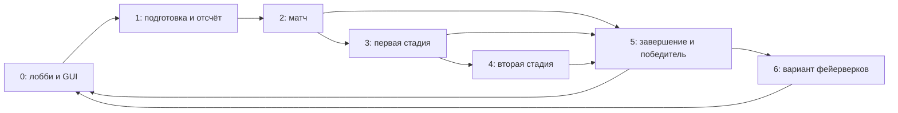

# Как работает исходный SkyWars

Сводка относится к трём пакетам `LBC`, `swarogskywars` и `maps`. Подробности и
точные исходники указаны в тематических документах; состояние полного исследования
видно в [RESEARCH_PROGRESS.md](RESEARCH_PROGRESS.md).
Проверенные сквозные маршруты предметов, обеих рук и очистки мира собраны в
[INTEGRATION_REVIEW.md](INTEGRATION_REVIEW.md).

## Java-реализации старого сервера

Этот workflow описывает datapack. Параллельно в Paper-плагине есть собственные
состояния игры, GUI, мана и слушатели предметов. Их запуск не равнозначен вызову
старых функций. В обоих просмотренных `config.yml` стоит `legacy.enabled: false`:
эта настройка пропускает регистрацию LegacyFunctionRuntime и SwrgNativeService,
а нативные сервисы продолжают создаваться.

Командные входы datapack связаны с [COMMAND_IMPLEMENTATIONS.md](COMMAND_IMPLEMENTATIONS.md).
Предметы через события/задачи — с [PLUGIN_ITEMS_AND_HOOKS.md](PLUGIN_ITEMS_AND_HOOKS.md).
Цикл нативного матча и незавершённые участки — с
[NATIVE_RUNTIME_OVERVIEW.md](NATIVE_RUNTIME_OVERVIEW.md).
Это описания исходников; запуск совместной конфигурации на сервере не проверялся.

## Роли пакетов

| Пакет | За что отвечает |
|---|---|
| `swarogskywars` | Лобби, меню, настройки, запуск/стадии матча, стандартные навыки, награды и возврат в лобби. |
| `LBC` | Кастомные предметы, мана/атрибуты, сущности и снаряды, игровые комплекты, дополнительные навыки и режимы, включая BedWars. |
| `maps` | NBT-шаблоны частей карт. Размещением, очисткой и выбором карты управляют функции других пакетов. |

Пакеты связаны через `function`, scoreboard, storage, entity tags, predicates,
advancements и loot tables. Чтобы понять предмет, нужно проследить его выдачу,
идентификацию, обработчик использования и завершение эффекта.

## От лобби до следующего матча

Числа — `#gamestat` в objective `swrg.math`. Переходы задаются функциями, а не
самим числом. Для обычного режима первая стадия планируется через 120 секунд;
вторая — через 360 секунд, если включена настройкой. BedWars запускается отдельной
веткой LBC. На схеме показаны основные переходы; конкретные проверки завершения,
жизни, команды и исключения разобраны в [skywars_game.md](skywars_game.md).

В лобби игрок выбирает настройки и комплект через GUI. Quickstart выбирает карту
с учётом числа игроков и режима. Загрузчик размещает части карты и маркеры,
после чего запуск распределяет игроков, сбрасывает состояние и включает матч.
Стадии запускают выбранные события. Завершение выдаёт награду, включает эффекты
победы и планирует возврат в лобби через 10 секунд.

## Независимые циклы обработки

- `minecraft:load` запускает загрузку LBC и SkyWars. Их записи в исходных тегах
  лежат в одинаковом пути разных пакетов; при встраивании в один мод их надо объединять.
- `lbc:tick` вызывается через `minecraft:tick`. Он выбирает обычную ветку либо
  ветку остановки времени и отдельно обрабатывает Nexus. Периодические ветки
  LBC используют собственные расписания и селекторы.
- `swrg:core/load` запускает `swrg:core/tick` и `tick1s`. Эти функции сами
  планируют следующий запуск и выбирают лобби/матч/эффекты победы по `#gamestat`.
- Advancement или GUI-событие может вызвать механику вне общего tick-диспетчера.
  Поэтому наличие функции в папке не показывает само по себе, когда она срабатывает.

Запланированные повторения и одноразовые события требуют отдельной проверки:
смена стадии не отменяет все уже поставленные вызовы. Пример — последний вызов
Wither/TNT после окончания стадии, описанный в [skywars_game.md](skywars_game.md).

## Кастомный предмет: что фиксируется в документации

1. **Выдача:** loot table, набор, крафт, событие или призванная сущность.
2. **Распознавание:** vanilla-основа, `custom_data`, entity tag или scoreboard.
3. **Вход:** клик, удержание, атака, бросок, подбор, поедание, тик либо advancement.
4. **Эффект:** кто получает урон/бонус, что появляется или меняется в мире.
5. **Ограничения:** мана, расход предмета, кулдаун, область, команда и владелец.
6. **Выход:** истечение времени, удаление маркера, смерть, reset или конец матча.

[lbc_core_items.md](lbc_core_items.md) показывает общий путь выброшенных предметов.
[lbc_drops.md](lbc_drops.md) описывает конкретные эффекты, включая old/new-варианты,
боссов и процедурный генератор предметов. Оружие описано в
[lbc_items_weapons.md](lbc_items_weapons.md), арканумы и тринкеты — в
[lbc_items_arcana_trinkets.md](lbc_items_arcana_trinkets.md), индикаторы — в
[lbc_ui.md](lbc_ui.md). Старые эмиттеры Sauvojen и объединение чёрных дыр находятся в
[lbc_raycast.md](lbc_raycast.md). Полный список готовых и очередных участков есть в
[INDEX.md](INDEX.md); все задания снимка приняты координатором.
Центральная регенерация, обратная мана, отрицательные пороги и лучи перегрузки
разобраны в [lbc_mana.md](lbc_mana.md). Полные 64 исхода крафта огненного осколка
и порядок расхода — в [lbc_craft_random_mana.md](lbc_craft_random_mana.md).

## Карты и границы известных данных

[maps_structures.md](maps_structures.md) объясняет размещение и маркеры.
[maps_catalog.md](maps_catalog.md) содержит строки по всем 1 456 NBT из заданных
пакетов; машинный каталог хранит полное существенное содержимое. Загрузчик использует
также ID, которым нет соответствия в этих трёх пакетах. Такие ссылки явно отмечены:
их наличие не доказывает отсутствия шаблона в `world/generated` или внешнем пакете.

Пустые loot tables, особенности контекста команд и времени собраны в
[SOURCE_FINDINGS.md](SOURCE_FINDINGS.md). Место встраивания данных в новый Fabric-мод —
в [DATAPACK_EMBEDDING.md](DATAPACK_EMBEDDING.md).

Подстановки серверных команд вынесены в [COMMAND_BRIDGES.md](COMMAND_BRIDGES.md).
Они показывают, например, передачу `mapclear`, `motion` и `bedwars`; реализация
команды не появляется автоматически от наличия macro helper в datapack.
